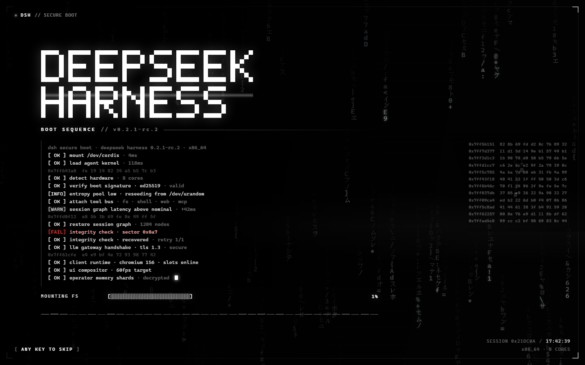
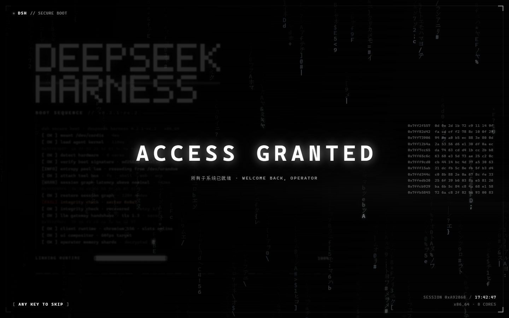

# dsh-boot-sequence

> DSH 的启动界面：黑底白字的数据流 + 终端安全启动序列。

打开 DSH 时先来一段约 4 秒的「安全启动」过场：白色字符雨铺满整屏，左边一台终端逐行打印自检日志，进度条一路解压到 100%，最后 `ACCESS GRANTED` 一闪，整屏淡出，进入正常界面。

- 纯前端、零依赖、零模型调用、不发任何网络请求
- 任意点击 / 按键即可跳过；默认每个会话只播一次，刷新不重复轰炸
- 字体无关：LOGO 用 SVG 点阵画，不依赖任何机器上的等宽字体
- 同一份代码可以脱离 DSH 在浏览器里直接预览（`preview.html`）

| 启动中 | 授权完成 |
| --- | --- |
|  |  |

完整过程（4.2 秒，1080×692）：[docs/dsh-boot-sequence.mp4](docs/dsh-boot-sequence.mp4)

## 安装

插件放在 `~/.dsh/local-plugins/`，并在 profile 里登记。仓库自带脚本，一条命令搞定（会先备份 profile 的 `package.json`）：

```bash
node tools/install.mjs            # 安装到 desktop profile
node tools/install.mjs --dry-run  # 只看会改什么
node tools/install.mjs --uninstall
```

装完重启 DSH 生效。

手动安装等价于三步：

1. 把本目录复制到 `~/.dsh/local-plugins/dsh-boot-sequence`
2. `~/.dsh/profiles/desktop/package.json` 里加依赖
   `"dsh-boot-sequence": "link:C:/Users/<你>/.dsh/local-plugins/dsh-boot-sequence"`，
   并在 `dsh.profile.bundles` 数组末尾加 `"dsh-boot-sequence"`
3. 在 `~/.dsh/profiles/desktop/node_modules/` 下建一个指向第 1 步目录的链接

## 交互

| 操作 | 效果 |
| --- | --- |
| 点击 / 任意键 | 跳过：立刻满进度 + `ACCESS GRANTED`，0.3 秒后淡出 |
| `Ctrl + Alt + B` | 重播（不受「每会话一次」限制） |
| 控制台 `dshBootSequence.replay()` | 同上 |

## 配置

在 DSH 页面的控制台里改 `window.DSH_BOOT`，下次播放生效：

```js
window.DSH_BOOT = {
  duration: 3000,        // 进度条跑满的时长（ms）
  grantedHold: 780,      // ACCESS GRANTED 停留（ms）
  fadeOut: 520,          // 淡出时长（ms）
  oncePerSession: true,  // 每个会话只播一次（sessionStorage 记账）
  rain: true,            // 数据流
  hex: true,             // 右侧十六进制流
  spectrum: true,        // 底部频谱条
  safeTop: null,         // 顶部安全区（px）。留空则自动测量桌面端标题栏高度
};
```

右上角是桌面端的窗口按钮（最小化 / 最大化 / 关闭），所以那里什么都不放：
`SESSION 0x… / 时钟` 和硬件信息都收在右下角，顶部只留左角一行 `DSH // SECURE BOOT`。
Tauri 桌面端会读标题栏高度（`--dbs-top`）让顶部元素避开，浏览器里为 0，布局不受影响。

只想在开发时看一次：打开 `preview.html`，或在 URL 后加 `?hold=boot` / `?hold=granted` 把画面冻结在对应阶段。
想模拟桌面端标题栏：加 `?safeTop=32`，预览页会画一条假的标题栏和三个窗口按钮。

## 结构

```
package.json        # dsh.bundle.patch + dsh.client（web）
cordis.patch.yml    # 往配置树里插一行 bundle
lib/index.js        # 宿主半侧：故意为空（纯客户端插件）
lib/client.js       # 浏览器半侧：整屏动画引擎
preview.html        # 脱离 DSH 的预览壳（迷你模块加载器 + 迷你 React）
tools/install.mjs   # 安装 / 卸载
tools/shot.mjs      # 用本机 Chrome + CDP 拍时间轴截图
tools/fps.mjs       # 量动画帧率（rAF 间隔 + 主线程耗时）
tools/record.mjs    # 录演示视频（CDP 抓帧 + ffmpeg 编码）
```

### 它是怎么挂上去的

浏览器半侧导出标准的 Cordis 三件套 `name / inject / apply`，在 `apply` 里往官方的全屏叠加槽注册自己：

```js
ctx.slots.inject('shell.overlay', function* () {
  yield ctx.slots.register(
    { name: 'shell.overlay', id: 'boot-sequence', order: 9000 },
    () => h(BootOverlay, {})
  );
});
```

用 generator + `yield` 的叠加式注册，不会顶掉桌宠等其它插件在同一槽位里的条目。

### 为什么动画不写在 React 里

`lib/client.js` 里的引擎是纯 DOM + Canvas：React 组件只负责在挂载时启动、卸载时清理。好处是同一份引擎代码可以在 `preview.html` 里用几十行迷你运行时跑起来——预览看到的就是 DSH 里跑的，不存在「预览版和正式版不一致」。

几个实现细节：

- **字符雨**：每列按整格下落，用半透明黑覆盖做拖尾衰减；少数列标成 hot，带辉光
- **LOGO**：5×7 点阵 → SVG `<rect>`，一行里连续的格合并成一个矩形，避免缩放时的接缝
- **终端日志**：一行一行打字，光标跟着走；`[FAIL]` 那一行是故意的，下一行会 `recovered`
- **可读性**：数据流上盖一层左深右浅的渐变，左边终端区始终压得住
- **真机信息**：版本 / 架构从 `navigator.userAgent` 读，核数用 `navigator.hardwareConcurrency`，
  OS / CPU / 精确内存来自桌面端的 `dshDesktop.deviceInfo()`；读不到就退回占位值，浏览器预览不会崩

### 性能

全屏动画最容易翻车的地方，这版都避开了：

- 字形**预渲染成图集**，每帧只 `drawImage` —— 逐帧 `fillText` + `shadowBlur` 是 canvas 上最贵的操作
- 画布**像素预算封顶**（160 万），超了自动降采样；字符雨本来就是糊的，肉眼无感
- 去掉所有全屏 `mix-blend-mode`（每帧都要 blend 整屏）和 `filter`
- 频谱条用 `transform: scaleY()` 而不是 `height`，不触发布局
- 日志区和十六进制流加 `contain: layout paint style`，高频重绘不外溢
- 打字机限到 ~33ms 一次，拖尾衰减按真实帧间隔换算，帧率变了尾巴长度也不变

改前改后的实测（无头 Chrome 软件渲染，1440×900，数字偏悲观）：
**10.2 fps → 50.9 fps**，1080×693 下 **55.6 fps**。用 `node tools/fps.mjs` 可复现。

录演示视频用 `node tools/record.mjs 5200 1080 692`：CDP 抓真实渲染帧（带时间戳），
再用 ffmpeg 按真实节奏编码。本机没装 ffmpeg 的话，用 `FFMPEG` 环境变量指向任意一份可执行文件即可。

## 卸载

```bash
node tools/install.mjs --uninstall
```

再把 `~/.dsh/local-plugins/dsh-boot-sequence` 删掉即可。

## License

MIT
